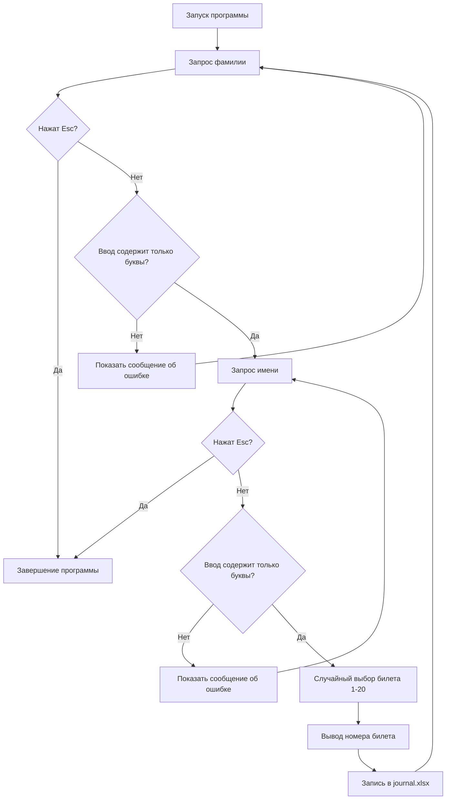
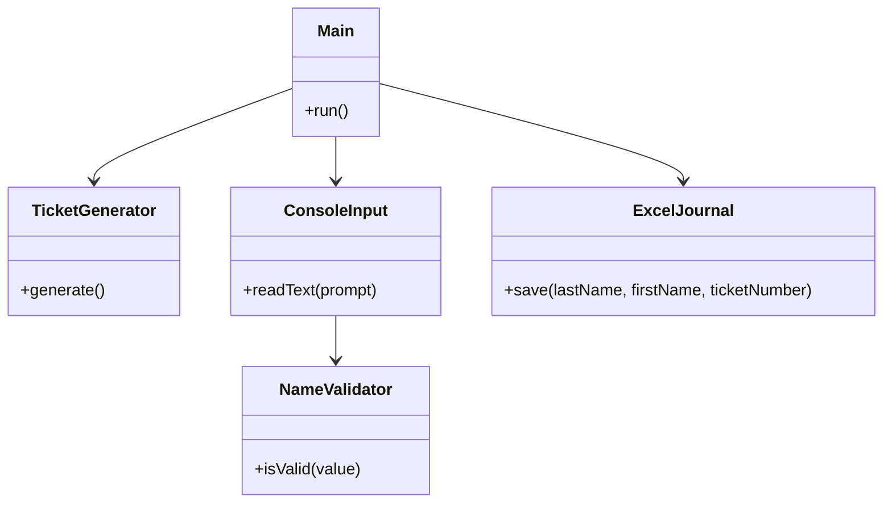

# Генератор экзаменационных билетов


Консольное приложение на Python для проведения цифровой выдачи экзаменационных билетов. Программа запрашивает фамилию и имя студента, проверяет текстовый ввод, случайным образом выбирает номер билета от 1 до 20 и сохраняет результат в файл `journal.xlsx`.

Проект рассчитан на локальное использование в среде Windows. Он не требует базы данных, сервера или графической оболочки — достаточно Python, библиотеки `openpyxl` и командной строки.

---

## Содержание

- [Возможности](#возможности)
- [Принцип работы](#принцип-работы)
- [Требования](#требования)
- [Установка и запуск](#установка-и-запуск)
- [Пример работы](#пример-работы)
- [Валидация ввода](#валидация-ввода)
- [Файл Excel-журнала](#файл-excel-журнала)
- [Структура проекта](#структура-проекта)
- [Описание функций](#описание-функций)
- [Работа с закрытым или открытым журналом](#работа-с-закрытым-или-открытым-журналом)
- [Обработка ошибок и ограничений](#обработка-ошибок-и-ограничений)
- [Архитектура и SOLID](#архитектура-и-solid)
- [Идеи для развития](#идеи-для-развития)

---

## Возможности

- интерактивный ввод фамилии и имени;
- выход из приложения клавишей `Esc`;
- защита от пустого ввода;
- защита от цифр и знаков препинания;
- поддержка кириллицы и латиницы;
- случайный выбор билета из диапазона от 1 до 20;
- сохранение всех выдач в журнал Excel;
- автоматическое создание журнала при первом запуске;
- добавление даты и точного времени выдачи;
- повторная попытка сохранения, если файл занят другим приложением.

## Принцип работы



После выдачи билета приложение не завершает работу, а возвращается к запросу фамилии и может обработать следующего студента. Завершить цикл можно клавишей `Esc`.

## Требования

| Компонент | Требование |
|---|---|
| Операционная система | Windows |
| Python | Рекомендуется 3.10 или выше |
| Библиотека | `openpyxl` |
| Консоль | PowerShell или стандартный терминал Windows |

Модуль `msvcrt`, используемый для определения клавиши `Esc`, доступен только на Windows. Поэтому запуск программы в Linux или macOS может потребовать отдельной доработки ввода.

## Установка и запуск

### 1. Перейдите в каталог проекта

```powershell
cd C:\Users\Kristina\Desktop\pad-ai\ExamTicketGenerator
```

### 2. Установите зависимость

```powershell
python -m pip install openpyxl
```

### 3. Запустите приложение

```powershell
python main.py
```

При запуске программа выводит подсказку о способе выхода:

```text
Для выхода нажмите ESC
```

## Пример работы

```text
Для выхода нажмите ESC
Last name: Иванов
First name: Иван
Билет № 12
Last name:
```

Если введён недопустимый символ:

```text
Last name: Иванов123
Разрешены только буквы. Введите значение без цифр и знаков.
Last name:
```

Для прекращения работы нажмите `Esc` на этапе ввода фамилии или имени. Программа сообщит:

```text
Программа завершена.
```

## Валидация ввода

Ввод фамилии и имени проходит общую проверку в функции `get_input_with_escape`.

### Допустимо

- русские буквы;
- латинские буквы;
- ввод с заглавной или строчной буквы.

### Недопустимо

- пустая строка;
- цифры;
- знаки препинания;
- пробелы внутри строки;
- другие специальные символы.

Проверка выполняется с помощью:

```python
all(character.isalpha() for character in value)
```

Метод `isalpha()` определяет, являются ли все символы буквами. Строка сначала очищается от пробелов в начале и конце методом `strip()`. Если проверка не пройдена, ввод не сохраняется и запрос повторяется.

## Файл Excel-журнала

По умолчанию файл журнала называется `journal.xlsx` и создаётся в том же каталоге, откуда запущена программа.

Если файла не существует, создаётся новая рабочая книга с заголовками:

| Столбец | Содержимое |
|---|---|
| `Last name` | Фамилия студента |
| `First name` | Имя студента |
| `Номер билета` | Случайно выбранный номер от 1 до 20 |
| `Дата и время` | Дата и время выдачи |

Пример строки журнала:

| Last name | First name | Номер билета | Дата и время |
|---|---|---:|---|
| Иванов | Иван | 12 | 18.11.2026 13:16:14 |

Файл `journal.xlsx` исключён из Git в [.gitignore](.gitignore), чтобы не публиковать персональные данные студентов.

## Структура проекта

```text
ExamTicketGenerator/
├── main.py                  # Основной код приложения
├── README.md                # Документация проекта
├── .gitignore               # Исключения для Git
├── journal.xlsx             # Журнал выдачи билетов
└── docs/
    └── images/
        └── project-overview.svg
```

## Описание функций

### `main()`

Управляет основным циклом программы:

1. запрашивает фамилию;
2. запрашивает имя;
3. выбирает случайный номер билета;
4. выводит номер билета;
5. сохраняет данные;
6. начинает новый цикл ввода.

### `get_input_with_escape(prompt)`

Запрашивает у пользователя непустое текстовое значение. При нажатии `Esc` возвращает `None`.

Функция использует `msvcrt.getwch()` для немедленного получения нажатой клавиши. Также выполняет:

- удаление лишних пробелов;
- проверку на пустое значение;
- проверку всех символов на буквенное значение;
- повторный запрос при ошибке.

### `save_student_to_excel(last_name, first_name, ticket_number)`

Сохраняет данные студента в `journal.xlsx`.

Если файла нет, функция создаёт новую книгу Excel и добавляет строку заголовков. Если файл существует, открывает его и добавляет новую строку в конец активного листа.

### Случайный выбор билета

Номер билета создаётся стандартным модулем `random`:

```python
ticket_number = random.randint(1, 20)
```

Метод включает обе границы диапазона, поэтому доступны билеты с номерами от 1 до 20 включительно.

## Работа с открытым журналом

При сохранении файла может возникнуть `PermissionError`, если он открыт и заблокирован Microsoft Excel.

В этом случае программа показывает сообщение:

```text
Не удалось сохранить данные. Возможно, файл journal.xlsx открыт в Excel.
Закройте файл и нажмите Enter для повторной попытки
```

После закрытия Excel нажмите `Enter`. Программа повторит попытку сохранения до успешного завершения.

## Обработка ошибок и ограничений

| Ситуация | Поведение |
|---|---|
| Пустой ввод | Сообщение об ошибке и повторный запрос |
| Цифры или знаки | Сообщение об ошибке и повторный запрос |
| Нажатие `Esc` | Завершение работы |
| Файл Excel открыт | Запрос закрыть файл и повторить сохранение |
| Файл отсутствует | Автоматическое создание файла |
| Linux или macOS | Требуется заменить `msvcrt` на кроссплатформенный ввод |

Приложение использует консольный режим. Не следует запускать его средством выполнения кода, которое не поддерживает интерактивный ввод с клавиатуры.

## Архитектура и SOLID

Код разделён на абстракции и классы отдельных обязанностей:

```text
ExamApplication
├── TextReader          — чтение текстового ввода
├── TextWriter          — вывод сообщений
├── TextValidator       — проверка текстового значения
├── TicketGenerator     — выбор номера билета
└── Journal             — сохранение записи
```

Такой дизайн отражает принципы SOLID:

- **SRP:** `LettersOnlyValidator` проверяет имя, `RandomTicketGenerator` выбирает билет, `ExcelJournal` сохраняет Excel-запись, а `ExamApplication` управляет сценарием.
- **OCP:** генератор билетов или журнал можно заменить другой реализацией без изменения логики приложения.
- **LSP:** все альтернативные реализации наследуют и корректно соблюдают контракты соответствующих абстракций.
- **ISP:** интерфейсы разделены по отдельным операциям: чтение, вывод, проверка, генерация и сохранение.
- **DIP:** `ExamApplication` зависит от абстрактных интерфейсов, а конкретные классы передаются через конструктор в точке сборки зависимостей.

Пример структуры взаимодействий:



## Идеи для развития

- проверять фамилии с дефисом и пробелами по специальным правилам;
- ограничивать длину имени и фамилии;
- поддерживать настраиваемый диапазон номеров билетов;
- исключать повторную выдачу одного билета;
- переключать приложения для конкретной группы или предмета;
- добавить экспорт отчёта;
- добавить автоматические тесты для валидатора;
- сделать интерфейс кроссплатформенным;
- добавить графический интерфейс.
